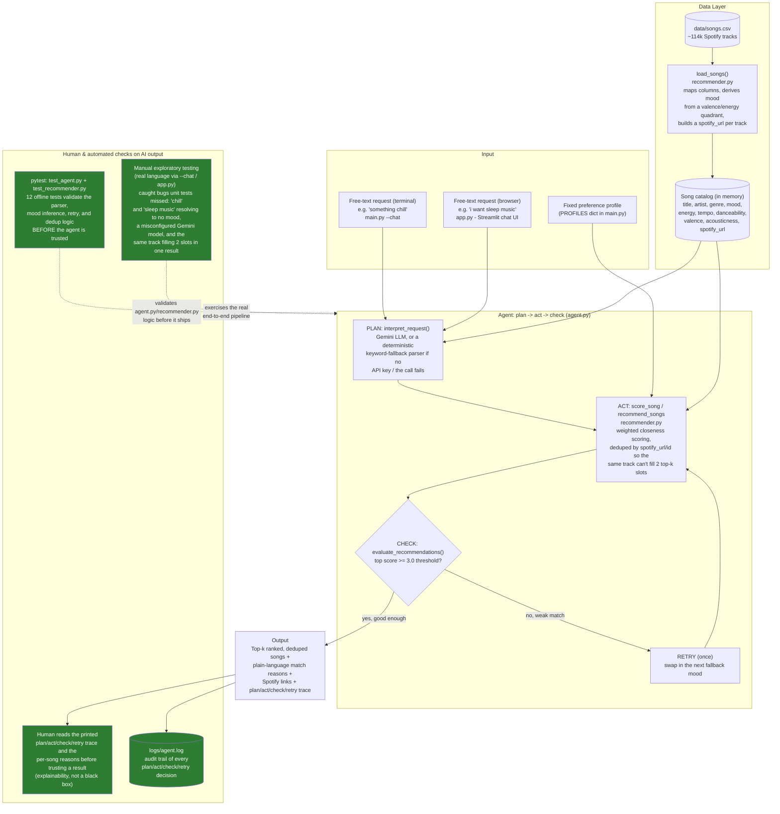

# System Architecture

Data flows left-to-right/top-to-bottom through four stages: a data layer that builds the
song catalog, an **input** (free text from the terminal or the Streamlit UI, or a fixed
profile), the **agent**'s plan → act → check loop, and an **output** of ranked, deduped,
explained recommendations with Spotify links. The green nodes at the bottom are where
humans or automated tests check the AI's output — offline unit tests validate the agent's
logic before it ships, manual exploratory testing against real language caught bugs the
tests missed, and every recommendation ships with a human-readable trace and reasons
instead of a bare score.

Mermaid source for this diagram also lives standalone at
[`system_architecture.mmd`](system_architecture.mmd).

